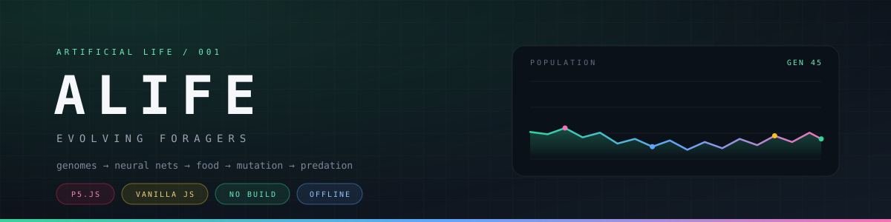

<p align="center">
  
</p>

<p align="center">
  <sub>A small artificial-life world in p5.js. Creatures carry a genome, run a tiny neural net, digest flora/fauna into ATP and biomass, regulate genes through a heritable network, and develop from a single cell into a body built from four tissues. A deterministic habitat with seasons, diet specialization, threat sensing, effort control, and morphology-dependent movement/defense create niches and coevolutionary pressure. Food is the only primary resource; everything else is evolution finding a way to convert it into copies of itself.</sub>
</p>

<p align="center">
  <a href="https://mithgfd.github.io/alife/">Live demo</a> · <a href="https://github.com/Mithgfd/alife">Source</a> · <a href="LICENSE">MIT License</a>
</p>

<br>

<p align="center"><sub>Current defaults emphasize realism (habitat niches, seasons, diet specialization, morphology, effort/threat behavior, and non-guaranteed predation). Measure stability and trait dynamics with <code>node validate.js</code> or, for a longer check, <code>SEEDS=1,2,3,4,5,6,7,8,9,10 TICKS=50000 node validate.js</code>.</sub></p>

---

## 01 — Quick start

```bash
open index.html        # macOS
xdg-open index.html    # Linux
```

No build step, no server, no install. `p5.min.js` is vendored, so it also works offline.

Every world has a seed. Open `index.html?seed=1234` to replay a specific run, or
press **share** to copy the current seed, speed, and toggles into the URL.

---

## 02 — The world

```text
alife/
  index.html   the page and toolbar
  sketch.js    p5 rendering + controls
  sim.js       headless simulation core (no p5, no DOM)
  p5.min.js    vendored, so it works offline
  test.js      one-run metrics and a pass/fail result
  repro.js     determinism, RNG isolation, save/load round-trip
  sweep.js     multi-seed parameter sweep
  validate.js  long-horizon check with immigrant-dependence reporting
  log.js       per-sample CSV of population and trait means
  ablate.js    compare regulation/allocation against neutral baselines
  smoke.js     headless browser smoke test (needs chromium)
  LICENSE      MIT
```

---

## 03 — Controls

The toolbar exposes everything; the keys are shortcuts.

| Key | Action |
|:---:|:---|
| <kbd>space</kbd> | Pause / resume |
| <kbd>1</kbd> <kbd>2</kbd> <kbd>3</kbd> <kbd>4</kbd> | Speed presets (also a fine speed slider in the toolbar) |
| <kbd>r</kbd> | Reset with a fresh random world |
| <kbd>p</kbd> | Toggle predation |
| <kbd>c</kbd> | Colour by genes or by species |
| <kbd>s</kbd> | Toggle sexual / asexual reproduction |
| <kbd>d</kbd> | Download the whole world as JSON |
| <kbd>l</kbd> | Load a saved world |
| <kbd>catalog</kbd> | Open the species catalog: every species that ever existed, alive/extinct status, peak, lifespan, and trait profile |
| <kbd>click</kbd> | Inspect a creature: identity, ATP/nutrient/biomass, cells, tissues, development, realized vs. gene traits, regulation, behavior |

The panel on the right shows world totals, mean realised traits, a stacked
population graph split by species, and a detailed inspector for the selected
creature. The species catalog lists every species that has ever existed with its
status, lifespan, peak, and trait profile. Tissue fractions are drawn as four
coloured arcs around each body: gut, muscle, nerve, gonad.

Creature colour comes from its `hue` gene (neutral, so it drifts into lineages).
Brightness is current ATP relative to its reproduction threshold — starving
creatures dim out. Switch to **colour: species** to see the clustering instead.

### Shareable URLs

| Parameter | Meaning |
|:---|:---|
| `seed` | Reproduce a run exactly |
| `speed` | `1`–`128` simulation steps per frame |
| `color` | `species` to start in species colour mode |
| `sexual` | `0` or `1` to force reproduction mode |
| `predation` | `0` to disable predation |
| `paused` | `1` to load paused |

---

## 04 — The model

### Genome

Eleven structural scalars, a small regulatory genome, and 117 neural-network weights (14 inputs, 6 hidden, 3 outputs). Older save brains are migrated on load.

| Gene | Range | What it does |
|:---|:---:|:---|
| `size` | 0.55 – 2.10 | Adult body mass (`mass = size²`); sets the growth target |
| `speedMax` | 0.20 – 2.20 | Top speed, before regulation and muscle allocation |
| `sense` | 12 – 110 px | Perception radius, before regulation and nerve allocation |
| `hue` | 0 – 1 | Colour only, neutral |
| `mutRate` | 0.02 – 0.60 | Mutation step size for its own offspring |
| `reproE` | 20 – 80 | ATP needed to reproduce (scaled by mass) |
| `enzyme` | 0.25 – 2.00 | Digestive catalyst abundance |
| `allocGut` | 0.05 – 1.00 | Adult biomass allocation to gut tissue |
| `allocMuscle` | 0.05 – 1.00 | Adult biomass allocation to muscle tissue |
| `allocNerve` | 0.05 – 1.00 | Adult biomass allocation to nerve tissue |
| `allocGonad` | 0.05 – 1.00 | Adult biomass allocation to gonad tissue |
| `devTiming` | 0.30 – 0.90 | Maturity fraction at which the adult body plan takes over |

`mutRate` is itself a gene, so evolvability is heritable. The four `alloc`
loci are relative weights: they are normalised into tissue fractions that sum to
one, so only their ratios matter.

### Gene regulation

`size` and `hue` are expressed directly. The other five functional traits
(`speedMax`, `sense`, `mutRate`, `reproE`, `enzyme`) pass through a small
recurrent network before they become realised traits.

```text
6 inputs -> 4 regulatory proteins -> 5 promoters
```

The inputs are nutrient level, ATP level, maturity, local crowding, food
proximity, and age. Each regulator relaxes toward a tanh target every tick, and
each promoter maps the regulator state to an expression multiplier between
`0.5×` and `1.5×` of the structural gene. The network's weights, promoter
biases, and promoter sensitivities are part of the genome and mutate and
recombine like the scalar genes.

A neutral regulatory genome (all zeros) expresses each structural gene exactly,
which is also what older save files load as. Regulation is therefore an
evolvable layer on top of the original model, not a replacement for it.

### Development and growth

Offspring are born as a single cell and grow by division. Cell count rises from
one toward an adult count proportional to `targetMass / cellMass`.

Growth is also differentiation. New biomass is split across four tissues:

| Tissue | Realised effect |
|:---|:---|
| Gut | Digestion rate and gut capacity |
| Muscle | Top speed, propulsion efficiency, maneuvering, and physical defense |
| Nerve | Perception radius, evasion/defense contribution |
| Gonad | Reproduction threshold |

Body mass and tissue composition also have functional morphology effects: larger bodies have more inertia (slower turning) and more drag; muscle improves turning and thrust efficiency; mass, muscle, and nerve contribute to defense against predation and failed attacks. These values are derived from biomass, genes, and regulatory state each tick.

The allocation program has two phases. Juveniles bias investment toward gut and
nerve, which keeps them alive while small. As maturity approaches `devTiming`,
the heritable adult allocation takes over. A gonad-heavy adult reproduces at a
lower energy threshold; a muscle-heavy adult is faster; a nerve-heavy adult
sees farther. Tissue fractions are displayed as coloured arcs around each body
and as numbers in the inspector.

Because tissue factors are relative to an even 25% allocation, a neutral body
plan leaves the old trait values unchanged. Development is a second evolvable
layer on top of regulation, not a hidden stat penalty.

### Brain

14 → 6 tanh → 3, fully connected.

Inputs are *egocentric* and local — forward/right relative to heading, plus internal and habitat state.

| # | Input | # | Input |
|:---:|:---|:---:|:---|
| 0 | Food forward | 7 | Bias |
| 1 | Food right | 8 | Gut fill (nutrient / capacity) |
| 2 | Food proximity | 9 | Local fertility |
| 3 | Creature forward | 10 | Local hazard |
| 4 | Creature right | 11 | Nearest food type (flora/fauna) |
| 5 | ATP / threshold | 12 | Season |
| 6 | Current speed / `speedMax` | 13 | Threat/prey cue (relative size) |

Outputs: `turn ∈ [−1, 1]`, `thrust ∈ [0, 1]`, `effort ∈ [0, 1]` (exertion/vigilance). Movement is shaped by morphology (turn rate, drag/inertia) and ecological context (resources, hazard, effort), and sprinting costs much more energy than cruising or resting.

> Egocentric inputs matter. With world-frame `dx/dy` the network has no idea which
> way it is facing, so "steer toward food" is not a linear function it can learn.
> With forward/right it is one positive weight.

Generation 0 is not pure noise: each genome gets an innate, evolvable
foraging reflex (food-right → turn, food/proximity → thrust, moderate effort;
idle thrust bias is low so resting is viable). Mutation can weaken, invert, or
rewire it like any other weight. In practice this reflex is a scaffold: random
founder brains without it usually fail to bootstrap, so the early dynamics
reflect tuning of a hand-seeded behavior as well as search from scratch. The
reflex is deliberate, but ablations and founder sensitivity are worth testing.

### Metabolism and diet

Food is **nutrient**, not usable energy, and comes in two types: **flora**
(common) and **fauna** (richer, rarer). Eating adds nutrient to the gut, capped
by `gutCap = (18 + 14 · size) · gutFactor`. Creatures track a recent diet mix.
Digestion is Michaelis-Menten and diet-dependent:

```text
flux = 5.0 · enzyme · digestibility(diet, enzyme) · nutrient / (nutrient + 12)
```

Flora digests readily; fauna yields more ATP/biomass but is harder to process
without sufficient enzyme. That makes `enzyme` and gut allocation real dietary
specialization axes. Digested nutrient yields ATP and biomass (building biomass
costs ATP), so growth and reproduction draw on the same budget. ATP is also
spent on basal maintenance, senescence, local hazard stress, and movement:

```text
cost = basal(age) + 0.04·mass + moveCost·mass^0.75·speed²·sprintPenalty + hazardCost·hazard·mass^0.75
```

Sprinting (near `speedMax`) is much more expensive than cruising; resting has
no movement cost. Starvation burns biomass back into ATP at a lossy `3.0` ATP
per biomass. A creature with no ATP and no body left dies. The enzyme gene is
heritable and regulated.

### Growth and reproduction

Offspring are born at 5% of adult mass and mature at 72%. Reaching adult size
requires both food and ATP, so a juvenile is a small, slow, conspicuous target.
Reproduction costs `0.52 × threshold`; the child receives
`0.42 × threshold`. The threshold is

```text
threshold = (30 + reproE · targetMass) · gonadFactor
```

The fixed term stops "be as small as possible" from being strictly optimal, and
`gonadFactor` lets a gonad-heavy body plan reproduce earlier.

### Sexual reproduction

On by default. A mature creature above `0.60 × threshold` looks for a compatible
mate within `mateRange` pixels. Both parents must be close enough in the six
functional genes (`mateRadius`), and each pays **half** the reproduction cost,
so two-parent reproduction costs the same total energy as one-parent
reproduction. The child inherits each scalar gene, each regulatory parameter,
and each neural weight from one parent, occasionally averages values, then
mutates at the parents' mean realised `mutRate`.

The half-cost rule matters: charging each parent the full cost makes sex a 2×
tax, and the population collapses whenever mates are scarce. Press <kbd>s</kbd>
to compare the two modes.

### Species

Every 90 ticks the world clusters living creatures over six functional genes —
`size`, `speedMax`, `sense`, `mutRate`, `reproE`, `enzyme`. `hue` is deliberately
excluded because it is neutral and would split lineages every time colour
drifted. Developmental allocation is also excluded: body plans can diverge
inside a lineage without instantly creating a new species label.

Clusters keep their id and colour while they have members. This is a
visual/statistical lens, not something the creatures can sense: nothing in the
simulation reads a species label. It exists so you can watch lineages diverge,
compete, and go extinct.

### Predation and defense

A creature can attack one much smaller than itself (`preySizeRatio`), but
capture is not guaranteed. Success depends on size advantage, speed/condition,
and prey defense (mass, muscle, and nerve/evasion). Failed attacks cost energy,
give the prey an escape impulse, and impose handling cooldown on the attacker.
Successful kills transfer ATP and biomass. Size still matters immediately, but
morphology and behavior can make prey harder to catch. Juveniles are especially
vulnerable because they start at 5% of adult mass.

### Food, habitat, and seasons

Logistic regrowth toward a cap, mostly clustered around slowly drifting
meadows. The world has deterministic spatial fertility and hazard fields, and a
slow seasonal cycle modulates fertility, hazard, and regrowth. Two food types
create dietary niches: **flora** (common) and **fauna** (richer, rarer, and
more enzyme-dependent). Food is nutrient and must be digested before it becomes
ATP or biomass.

### Seed bank

If the population falls below 20, competent random genomes trickle in. This is
the difference between "an interesting crash" and "a dead world you have to
restart".

---

## 05 — Determinism and saves

Each `World` owns a seeded RNG. A seed fully determines the run, two worlds can
exist side by side without sharing randomness, and the simulation never calls
`Math.random`.

Saving writes the full state: seed, habitat seed, RNG position, tick, parameters,
patches, food (including type), every creature's structural genes, regulatory
genome and current regulatory activity, neural weights, ATP, nutrient, diet,
biomass, cooldown/state, and the species table. Tissue fractions, morphology
(turn rate/drag/defense), and cell count are derived from biomass, genes, and
regulatory state, so they are recomputed deterministically on load. Loading a
save continues the *same* run, not merely a similar one — `repro.js` checks
that two worlds are byte-identical 2,000 ticks after a save/load round-trip.

The save format is version 7. Versions 1–6 still load: missing regulatory,
developmental, diet/habitat, and expanded brain fields are migrated to
compatible defaults, and older 8/2 or 12/2 neural networks are migrated into the
current 14/3 layout.

```bash
node repro.js
```

---

## 06 — Knobs worth turning

All in `DEFAULTS` at the top of `sim.js`.

| Param | Effect |
|:---|:---|
| `foodGrowth` | Carrying capacity / regrowth rate (modulated by season). Main population dial. |
| `foodCap` | How much food can exist at once. |
| `foodEnergy`, `foodEnergyFauna`, `faunaChance` | Nutrient value and rarity of flora/fauna; creates dietary niches. |
| `habitatScale`, `habitatStrength`, `hazardStrength` | Spatial fertility/hazard fields (deterministic niches). |
| `hazardCost`, `senescenceAge`, `senescenceCost` | Habitat stress and age-related maintenance. |
| `maxPop` | Hard ceiling. If the population pins here, selection is neutral. |
| `predation` | Turn it off for a pure foraging world. |
| `preySizeRatio` | Minimum size advantage to attempt predation. |
| `preyEnergyGain`, `preyMassGain` | Rewards from a successful kill (capture is probabilistic). |
| `basal`, `moveCost`, `sprintCost` | Maintenance and movement cost; sprinting near `speedMax` is expensive. |
| `idleDamp`, `senseDrive` | How much ecological drive/motivation affects movement with brain effort. |
| `thresholdBase` | Fixed reproduction cost; keeps small bodies from being free. |
| `digestRate`, `digestKm` | Digestion speed and half-saturation. |
| `atpYield`, `biomassYield`, `faunaAtpYield`, `faunaBiomassYield` | ATP/biomass yields by diet type. |
| `faunaDigestBase`, `faunaDigestEnzyme` | How hard fauna is to digest without enzyme specialization. |
| `growthCost` | ATP per biomass built; growth versus reproduction trade-off. |
| `catabolism` | ATP recovered per biomass burned while starving (lossy). |
| `birthMassFrac`, `matureFrac` | How small offspring start and when they can reproduce. |
| `cellMass` | Biomass per cell; sets the adult cell count. |
| `regRelax` | How fast regulatory proteins relax toward their network target. |
| `patchBias` | 0 = uniform food, 1 = fully clustered. |
| `immigrationBelow` | Extinction insurance. |
| `sexual` | Default reproduction mode. |
| `mateRange`, `mateMinEnergy`, `mateRadius` | Mate search, readiness, and genetic compatibility. |
| `speciesRadius`, `speciesInterval` | Species clustering (visual/statistical lens). |

---

## 07 — Headless tools and evidence

The whole point of keeping `sim.js` free of p5 is that you can measure the
dynamics instead of squinting at the canvas.

```bash
node test.js 40000                      # one run, prints summary; exits 1 on extinction
SEED=7 node test.js                     # a different world
node repro.js                           # determinism, RNG isolation, save/load round-trip
node sweep.js                           # configs × seeds, prints a comparison table
node validate.js                        # 5 seeds × 40k ticks; reports immigrant dependence
IMMIGRATION_BELOW=0 node validate.js    # no seed bank: tests evolutionary persistence
STRICT=1 node validate.js               # also fail on heavy seed-bank dependence
node log.js > run.csv                   # per-sample CSV for plotting traits over time
IMMIGRATION_BELOW=0 node log.js > native.csv
node ablate.js                          # compare layers against neutral/random baselines
IMMIGRATION_BELOW=0 node ablate.js      # ablations without seed-bank rescue
node smoke.js                           # loads the page in headless chromium, checks the UI
```

`test.js`, `repro.js`, `sweep.js`, `validate.js`, `log.js`, and `ablate.js` are
seed-driven, so results are reproducible. `smoke.js` needs `chromium` on
`PATH`.

**Seed bank / ancestry.** By default `immigrationBelow` injects random genomes
when the population crashes, which can mask extinction. `validate.js` and
`log.js` report `native%` / `immDesc` (fraction of the living population that
descends from injected immigrants). Run with `IMMIGRATION_BELOW=0` to test
whether lineages persist by evolution and reproduction alone.

**Drift control.** `hue` is a neutral marker (no fitness effect). `log.js`
writes `hue` (circular mean) and `hueSpread` alongside functional traits
(`size`, `speed`, `sense`, `enzyme`, `diet`, `defense`, tissues, ...). If a
functional trait shifts much more than `hue` drifts, that is evidence of
selection; shifts comparable to `hue` are consistent with drift.

**Layer ablations.** `ablate.js` compares `default` against `no-reflex`
(founders/immigrants start with fully random brain weights), `scrambled-brain`
(no heritable/adaptive control), `neutral-rg` (regulation forced to structural
expression), and `fixed-alloc` (even adult body plan). If a variant performs
about as well as default (population, persistence, native fraction, traits),
that layer may not be contributing much in the current environment. Use longer
`TICKS` and multiple `SEEDS` for meaningful comparisons.

`validate.js` exits 1 if any run goes extinct (and, with `STRICT=1`, if a run is
pinned at `maxPop` or remains seed-bank dependent after burn-in).

---

<br>

<p align="center"><sub>p5.js · vanilla JavaScript · no build · works offline</sub></p>
